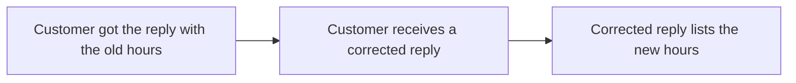

## Summary

The saved reply for delayed orders lists 8:00 to 20:00 every day, with 25 December closed, and customers who got the old hours receive a corrected reply. The start date waits for an answer.

## Background

Since 2026-10-01, support answers from 8:00 to 20:00, but the saved reply for delayed orders still lists 9:00 to 17:00.

Support sends that reply to each customer whose order is delayed. On public holidays, support keeps the same hours and closes on 25 December. The change covers only this reply.

## Proposed solution

Change the hours in the text of the saved reply, and send a corrected reply to customers who got the old hours.

| Alternative | Why not |
|---|---|
| Keep the hours in one shared setting | Every saved reply would need a change to read the setting. |

### Support hours

| Day | Today | After |
|---|---|---|
| Monday to Friday | 9:00 to 17:00 | 8:00 to 20:00 |
| Saturday, Sunday and public holidays | 9:00 to 17:00 | 8:00 to 20:00 |
| 25 December | 9:00 to 17:00 | Closed |

- If the answer is to leave 25 December out, the reply lists 8:00 to 20:00 every day.

### Saved reply for delayed orders

### Customers who got the old hours

- If the answer is to send nothing more, only new replies list the new hours.

### Start date

- No picture: this part waits for the answer on the date from which the reply lists the new hours.

## Sources

No public page and no file.
