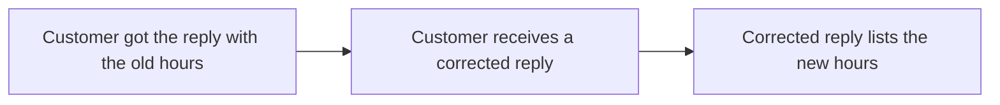

## Summary

The saved reply for delayed orders lists the new support hours, 8:00 to 20:00 every day, with 25 December closed. Customers who got the old hours receive a corrected reply.

## Background

The saved reply for delayed orders lists support hours that are no longer right.

When an order is delayed, support sends the customer a saved reply. That reply lists the support hours as 9:00 to 17:00. Since 2026-10-01, support has answered from 8:00 to 20:00, so every customer who gets the reply reads hours that are no longer right.

The new hours are the same every day, on weekends and on public holidays too, except 25 December, when support is closed. The change covers the reply for delayed orders only.

## Proposed solution

### Support hours

| Day | Today | After |
|---|---|---|
| Monday to Friday | 9:00 to 17:00 | 8:00 to 20:00 |
| Saturday, Sunday and public holidays | 9:00 to 17:00 | 8:00 to 20:00 |
| 25 December | 9:00 to 17:00 | Closed |

- If the answer to the question on 25 December is to leave it out, 25 December has the same hours as every other day.

### Saved reply for delayed orders

- The rest of that reply, and the other saved replies, stay as they are.

### Customers who got the old hours

- If the answer to the question on a corrected reply is to send nothing more, only new replies list the new hours.

### Start date

- No picture: this part waits for the answer to the question on the date from which the reply lists the new hours.

## Sources

No public page and no file.
