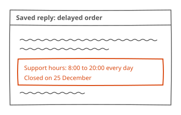

## Background

When an order is delayed, support sends the customer a saved reply. That reply lists the support hours as 9:00 to 17:00. Since 2026-10-01, support has answered from 8:00 to 20:00, so every customer who gets the reply reads hours that are no longer right.

The new hours are the same every day, on weekends and on public holidays too, except 25 December, when support is closed. The change covers the reply for delayed orders only.

## Proposed solution

The saved reply for delayed orders lists the support hours as 8:00 to 20:00 every day, on weekends and public holidays too, and lists 25 December as closed. If the answer to the question on 25 December is to leave it out, the reply lists the hours with no exception.

Customers who got the reply with the old hours receive a corrected reply with the new hours. If the answer to the question on a corrected reply is to send nothing more, only new replies list the new hours.

The date from which the reply lists the new hours has no proposal until its question is answered.

The rest of that reply, and the other saved replies, stay as they are.

## Sources

No public page and no file.
